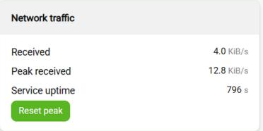

# Шаблон сервиса для Wiren Board

## Что делает

Показывает в веб-интерфейсе контроллера, сколько данных приходит по сети. На странице
«Устройства» появляется устройство «Сетевой трафик»: текущая скорость приёма, пик с момента
запуска и время работы самого сервиса. Кнопка сбрасывает пик, когда нужно померить заново.



Это нужно, чтобы видеть, идёт ли обмен вообще и кто занимает канал: замерший на нуле приём
означает, что связь встала, а разовый всплеск в пике покажет, что кто-то выкачал большой
объём, даже если к моменту просмотра всё уже успокоилось. На эти значения можно повесить
сценарий — например, прислать уведомление при превышении порога.

Какой интерфейс смотреть и как часто — настраивается там же, в веб-интерфейсе. Если
интерфейс в настройках указан неверно, показатель помечается ошибкой, а сервис продолжает
работать.

> ### Как превратить шаблон в свой сервис (этот раздел потом удалить)
>
> Всё внутри этой цитаты относится только к самому шаблону и в вашем сервисе не нужно.
>
> Как устроен сервис WB, откуда берётся версия, как работают тесты и сборка пакета:
> [docs/wb-service-guide.md](docs/wb-service-guide.md). Это пояснения к шаблону,
> в готовом сервисе файл не нужен.
>
> 1. Создайте репозиторий кнопкой **Use this template** на GitHub.
> 2. Переименуйте пакет. Имя шаблона встречается в нескольких местах, найти все:
>    `git grep -l wb-nodejs-service-template`
>    Менять нужно и содержимое файлов, и имена самих файлов: `debian/control`,
>    `debian/changelog`, файлы `debian/<имя>.*`, обёртку в `bin/`, конфиг, схему
>    и скрипт для `/etc/wb-configs.d`.
> 3. Начните `debian/changelog` со своей версии и своего авторства.
> 4. Раскомментируйте вызов сборки в `Jenkinsfile`. В шаблоне он закомментирован намеренно,
>    иначе Jenkins собирал бы сам шаблон и публиковал его в релизный фид.
> 5. Замените заголовок и описание выше на описание своего сервиса.
> 6. Удалите пояснения к шаблону: `git rm docs/wb-service-guide.md`
> 7. Удалите этот раздел целиком, от заголовка до конца цитаты.
>
> **Проверить, что ничего не забыли:** `git grep -n wb-nodejs-service-template`
> не должна находить ничего за пределами этого раздела.

## После клонирования

Один раз на каждый клон включите git-хуки, которые лежат в репозитории:

```bash
git config core.hooksPath hooks
```

После этого перед каждым `git push` прогоняются тесты, и при падении пуш отменяется.
Отправить без проверки, если очень нужно: `git push --no-verify`.

Проверить, что включилось: `git config core.hooksPath` должна вывести `hooks`.

## Сборка и проверка

Собрать пакет:

```bash
dpkg-buildpackage -rfakeroot -us -uc
```

Прогнать тесты локально:

```bash
node --test
```

Установить и проверить на контроллере:

```bash
systemctl status <имя-сервиса> && journalctl -u <имя-сервиса> -n 20
```

## Что внутри

| Что | Где |
|---|---|
| Код сервиса | `src/` |
| Точка входа, которая ставится в `/usr/bin` | `bin/` |
| Тесты | `tests/` |
| Сборка пакета, юнит, скрипты установки | `debian/` |
| Git-хуки репозитория | `hooks/` |
| Конфиг по умолчанию и схема для веб-интерфейса | в корне |
| Пояснения к шаблону (удаляются вместе со служебным разделом) | `docs/` |
